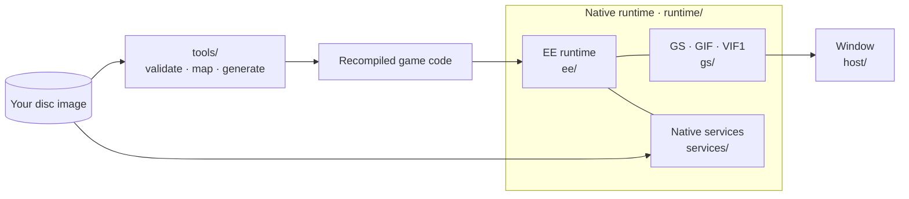

  

<h1 align="center">BT2 Recomp</h1>

Dragon Ball Z: Budokai Tenkaichi 2 · Native Windows x64 recompilation

<strong>SLUS-21441</strong> &nbsp;·&nbsp; <strong>C++20</strong> &nbsp;·&nbsp; <strong>MSVC / CMake</strong> &nbsp;·&nbsp; <strong>Early development</strong>

  <a href="#progress">Progress</a> &nbsp;·&nbsp;
  <a href="#building">Build</a> &nbsp;·&nbsp;
  <a href="#documentation">Documentation</a> &nbsp;·&nbsp;
  <a href="#credits--license">Credits &amp; license</a>

BT2 Recomp is a native Windows port of the PS2 game: its code is recompiled to C++ with PS2Recomp and runs on a small native layer instead of an emulator. Target: the North American release, **SLUS-21441**. Versus battles are playable with a controller; story mode, saving and performance are in progress.

> **Game files are not included.** You need your own legally obtained copy. This repository holds only project code, tools and documentation.

## Progress
<!-- progress-summary:start -->

| Milestone | Status |
| --- | --- |
| Startup | ✅ Verified — boot, modules answered natively, frame loop; key states match captures of the original |
| Controller and card checks | ✅ Verified — native services; the no-card prompt matches the original |
| Films | 🟢 Operational — logo and opening films with sound, also after a skip |
| Title and menus | 🟢 Operational — title, New Game and all ten main-menu screens; the screens explored past their first page without input, Item Fusion checked |
| Versus battle | 🟢 Operational — 1P vs COM with a controller; CPU vs CPU for characters 0 to 129 on all 16 stages (sampled) |
| Story mode | 🟢 Operational — without input: all 200 playable parts to their battle's end, and all 73 towns behind optional markers (conversations, items, Dragon Balls, the shop, fights); not yet played through by the user |
| Audio | 🟢 Operational — music, voices and effects; confirmed by the user's listening |
| Saves | 🔧 Incomplete — the user's save loads; saving not yet tried in the game |

**Code:** 11,139 EE functions plus 494 in the `DBZP.BIN` overlay, all compiled natively; the gate's runs and the story sweep interpret nothing · **Gate:** unit tests, Python suites, 32/32 comparisons with the original, the battle run against its baseline.
<!-- progress-summary:end -->

Statuses: ✅ Verified · 🟢 Operational · 🔧 Incomplete · ⛔ Blocking · ⏳ Not Reached.

**Next:** runtime special cases found by the coverage runs, then performance: fights at a steady 30 frames per second. [Full progress](docs/PROG.md) · [What has been checked](docs/progress/VALIDATION.md) · [History](docs/progress/2026-10.md)

## Building

**Windows 10/11 x64 · Visual Studio 2022 with C++ tools · CMake**

Running the game needs your own disc image: the [build guide](docs/guides/BUILDING.md) prepares the game files, generates the code and builds it.

## Architecture

The game's code is recompiled ahead of time into native C++. A small handwritten layer provides what it asks of the PS2.

| Part | Role |
| --- | --- |
| **EE runtime** | Memory, kernel, threads, timers, DMA, IPU, VU1 |
| **Native services** | Answer the game's IOP requests on the host (disc, files, controller, memory card, sound, CRI); no IOP code runs |
| **GS** | GPU rendering through paraLLEl-GS (Vulkan); a CPU renderer draws 2D and is the test reference |
| **Checked boundaries** | Unsupported behavior stops the run instead of guessing; results are compared with captures of the original game |

## Documentation

| Document | Contents |
| --- | --- |
| [Build and test](docs/guides/BUILDING.md) | Host build, game-file preparation, startup probe |
| [Progress](docs/PROG.md) | Measurements, subsystem status, next steps |
| [Implementation plan](docs/project/IMPLEMENTATION_PLAN.md) | Goals, direction and working rules |
| [Runtime layout](docs/guides/RUNTIME_LAYOUT.md) · [Tools](docs/guides/TOOLS.md) | Where code lives; local tooling |
| [Reference architecture](docs/reference/REFERENCE_ARCHITECTURE.md) | Reference projects and how they are used |
| [Content and licenses](docs/project/LEGAL.md) | Game-file policy and dependency licenses |

## AI tools

AI tools are used for coding, investigation and documentation. Changes are checked with automated tests and comparisons against the original game; unverified work is labeled in the progress records.

## Credits & license

Project owner and maintainer: [oric212](https://github.com/oric212).

| Project | Contribution |
| --- | --- |
| [PS2Recomp](https://github.com/ran-j/PS2Recomp) by ran-j and contributors | Static recompiler (GPL-3.0) |
| [BT3-Recomp](https://github.com/z3xox/BT3-Recomp) and [Tenkaichi3Decomp](https://github.com/z3xox/Tenkaichi3Decomp) by z3xox and contributors | Architecture and tooling references; native-layer approach |
| [paraLLEl-GS](https://github.com/Arntzen-Software/parallel-gs) by Arntzen Software | GPU GS renderer (LGPL-3.0) |
| [PCSX2](https://github.com/PCSX2/pcsx2) · [PS2SDK](https://github.com/ps2dev/ps2sdk) | Behavior references and original-game comparison captures |
| [Ghidra](https://github.com/NationalSecurityAgency/ghidra) | Function discovery |

### License and game ownership

This repository is **GPL-3.0** (see [LICENSE](LICENSE)). *Dragon Ball Z: Budokai Tenkaichi 2* © Spike / Bandai Namco. This project is not affiliated with or endorsed by them; it exists for preservation and interoperability and distributes no game content. Game code is recompiled locally during the generation/build workflow from files supplied from the user's own disc image; proprietary-derived generated code is not distributed in this repository.