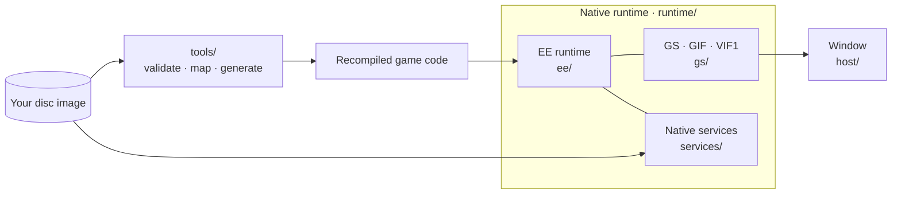

  

<h1 align="center">BT2 Recomp</h1>

Dragon Ball Z: Budokai Tenkaichi 2 · Native Windows x64 recompilation

<strong>SLUS-21441</strong> &nbsp;·&nbsp; <strong>C++20</strong> &nbsp;·&nbsp; <strong>MSVC / CMake</strong> &nbsp;·&nbsp; <strong>Early development</strong>

  <a href="#progress">Progress</a> &nbsp;·&nbsp;
  <a href="#enhancements">Enhancements</a> &nbsp;·&nbsp;
  <a href="#system-requirements">Requirements</a> &nbsp;·&nbsp;
  <a href="#building">Build</a> &nbsp;·&nbsp;
  <a href="#documentation">Documentation</a> &nbsp;·&nbsp;
  <a href="#credits--license">Credits &amp; license</a>

BT2 Recomp lets you play the PS2 game *Dragon Ball Z: Budokai Tenkaichi 2* (USA version, **SLUS-21441**) as a normal Windows program. It is not an emulator: the game's own code is translated into C++ with PS2Recomp, and a small layer stands in for the parts of the PS2 the game uses.

Every mode can be played. Versus battles run at the original speed, story mode and the other modes play through, saves are identical to the original game's, and two players can fight each other online.

The port has been checked carefully against the original game running in PCSX2. The fight, its graphics, the first menus and the game's requests to the PS2 all give the same results ([how it was compared](docs/plans/validation/PCSX2_COMPARISON_PLAN.md)). It has also been played on several PCs, and online between two homes.

You can turn on optional extras: HD textures, a sharper picture, widescreen, 60 fps battles, fast loading and quick start. It works with a keyboard, Xbox controllers, DualSense, DualShock 4 and most other gamepads (such as 8BitDo), and every button can be changed.

**Download:** get [BT2 Recomp v0.2](https://github.com/oric212/BT2-Recomp/releases/tag/v0.2), unzip it, put your USA disc image (`.iso`) into its `data` folder and start `bt2-launcher.exe`. The `README.txt` inside explains the rest and lists the known problems.

> **Game files are not included.** You need your own legally obtained copy. This repository holds only project code, tools and documentation.

## Progress
<!-- progress-summary:start -->

| Part of the game | Status | What this means |
| --- | --- | --- |
| Startup | ✅ Matches the original | The game starts and reaches its main loop. Its state at key moments is the same as in PCSX2. |
| Controller and memory card checks | ✅ Matches the original | The checks at boot work, and the "no memory card" message appears as on the PS2. |
| Films | ✅ Matches the original | The logo and opening films play with sound. Every picture is decoded exactly as PCSX2 decodes it. |
| Title and menus | ✅ Matches the original | The main menu, the Dueling menu and character selection behave exactly as in PCSX2. Every mode has been played. |
| Versus battle | ✅ Matches the original | A fight runs exactly as in PCSX2, frame by frame. All 130 fighters and all 16 stages have been run. |
| Story mode | 🟢 Tested | Partly played. All 200 story parts and 73 towns have been run. |
| Sound | 🟢 Tested | Music, voices and effects are mixed the way the game's own sound driver mixes them. Checked by listening. |
| Saves | ✅ Matches the original | Save files are identical, byte for byte, to the ones the original game writes. |
| Enhancements | 🟢 Tested | HD textures, super-sampling up to 16x, widescreen, 60 fps battles, fast loading and quick start. |
| Online battle | 🟢 Tested | Two players on different PCs fight over the internet, joined by a code. Played between two homes. |

**Code:** all 11,139 functions of the game's main program, and the 494 in its `DBZP.BIN` file, are compiled to
native code. **Checks:** every change must pass the gate before it is committed: the unit tests, 31 comparisons of
startup with the original game, and a scripted fight whose result must equal a recorded one.
<!-- progress-summary:end -->

What the statuses mean:

- ✅ **Matches the original:** compared with the original game running in PCSX2, for the part described.
- 🟢 **Tested:** played or listened to on several PCs, but not compared with PCSX2.
- 🔵 **Runs:** reached by automated runs only.
- 🔧 **Incomplete**, ⛔ **Blocking**, ⏳ **Not reached yet.**

More: [full progress](docs/PROG.md) · [comparison with PCSX2](docs/plans/validation/PCSX2_COMPARISON_PLAN.md) · [what has been checked](docs/progress/VALIDATION.md) · [history](docs/progress/2026-11.md)

## Enhancements

All of these are optional. Turn them on in the launcher, or in the in-game menu (Escape, or the PS button on a PlayStation controller); they take effect the next time the game starts.

**None of them changes how the game plays.** Fights keep the original speed and physics. If your PC can't keep up with an enhancement, the enhancement steps back instead of slowing the game down.

| Enhancement | What it does |
| --- | --- |
| **HD textures** | Replaces the game's textures with sharper ones from a PCSX2 texture pack. The fighters' bodies get HD textures too, lit by the game as usual. Supported pack: [Sal9im's AI-upscaled pack](https://gbatemp.net/threads/dragon-ball-z-tenkaichi-budokai-2-slus-21441-ai-upscaled-texture-pack.658938/) (not included). Put its folder in `data/textures`. |
| **Super-sampling** | A sharper, smoother picture: each pixel is drawn 2 to 16 times. From 4x up, the picture is twice the PS2's resolution. |
| **Widescreen** | Fights, cut-scenes and the story map in 16:9. |
| **60 fps battles** | Adds a picture between each two of the game's 30 frames a second. The fight itself still runs exactly as on the PS2. |
| **Fast loading** | Shorter loading screens. On by default. |
| **Beam struggles by buttons** | Press Square in a beam struggle instead of turning the stick. On by default. |
| **Quick start** | Skips the logos, the opening film and the title screen, and goes straight to the main menu with your save loaded. If the memory card has no save yet, one is created. Off by default. |
| **Display** | Sharp (integer) or smooth scaling, window size, fullscreen, **Variable refresh rate** for displays that support it, and **Low input lag**, which shows each picture as soon as it is drawn (on by default). Hold **Tab** to fast-forward. |
| **Online battle** | Fight a player on another PC: one of you hosts and the other joins with the host's code ([setup guide](docs/guides/release/ONLINE_SETUP.md)). |

## System requirements

These are estimates. They were measured on one PC (Core i9-10900K, with a Radeon RX 6800 XT and an RX 9070 XT). Slower processors were simulated by turning off cores, and other graphics cards were estimated from its timings. The speed of a single processor core matters most. On a weaker graphics card, choose a lower super-sampling setting.

| | Minimum (original picture) | Recommended (every enhancement) |
| --- | --- | --- |
| **System** | Windows 10 or 11, 64-bit | Windows 10 or 11, 64-bit |
| **Processor** | 4 cores: Core i5-6500, Ryzen 3 1200 | 4 cores, 8 threads: Core i7-7700, Core i3-12100, Ryzen 5 2600 |
| **Memory** | 4 GB | 8 GB |
| **Graphics** | Vulkan: GeForce GTX 1050 Ti, Radeon RX 570, Arc A380 | GeForce RTX 3070, Radeon RX 6700 XT (with 4x instead of 16x: RTX 3060, RX 6600 XT) |
| **Video memory** | 2 GB | 4 GB |
| **Storage** | 3.2 GB | 12 GB (with the 8.3 GB texture pack) |

## Building

You need Windows 10 or 11 (64-bit), Visual Studio 2022 with its C++ tools, and CMake. The [build guide](docs/guides/BUILDING.md) takes you through it: it prepares the game files from your disc image, turns the game's code into C++ and builds the programs.

When the build is done, put your `.iso` into the `data` folder next to `bt2-game.exe` and start `bt2-launcher.exe`. Your memory cards are kept in the `saves` folder beside it; the [saves guide](docs/guides/release/SAVES.md) explains backups, moving saves and bringing them over from PCSX2.

## Architecture

The game's code is translated into C++ once, before it runs. A small hand-written layer then answers everything the game asks of the PS2.

| Part | Role |
| --- | --- |
| **EE runtime** | Stands in for the PS2's main processor and its surroundings: memory, system calls, threads, timers, data transfers (DMA), the video decoder (IPU) and the vector unit (VU1). |
| **Native services** | The PS2 has a second processor (the IOP) for the disc, files, controllers, memory card, sound and the CRI middleware. The port answers those requests directly on the PC and runs no IOP code. |
| **GS** | The PS2's graphics chip. Its drawing commands are checked and then drawn on your graphics card by paraLLEl-GS (Vulkan). |
| **Checked boundaries** | If the game asks for something the port does not support, the run stops and names it instead of guessing. Results are compared with the original game running in PCSX2. |

## Documentation

| Document | Contents |
| --- | --- |
| [Build from source](docs/guides/BUILDING.md) | Tools, game files, generating the code, building and checking |
| [Player guide](docs/guides/release/README.md), [saves](docs/guides/release/SAVES.md), [online](docs/guides/release/ONLINE_SETUP.md) | The guides that come with the release |
| [Progress](docs/PROG.md) | Status, measurements, next steps |
| [Comparison with PCSX2](docs/plans/validation/PCSX2_COMPARISON_PLAN.md) | What matches the original and what was fixed |
| [Implementation plan](docs/project/IMPLEMENTATION_PLAN.md) | Goals, direction and working rules |
| [Runtime layout](docs/guides/RUNTIME_LAYOUT.md) · [Tools](docs/guides/TOOLS.md) | Where code lives; local tooling |
| [Reference architecture](docs/reference/REFERENCE_ARCHITECTURE.md) | Reference projects and how they are used |
| [Content and licenses](docs/project/LEGAL.md) | Game-file policy and dependency licenses |

## AI tools

AI tools are used for coding, investigation and documentation. Changes are checked with automated tests and comparisons against the original game; unverified work is labeled in the progress records.

## Credits & license

Project owner and maintainer: [oric212](https://github.com/oric212).

| Project | Contribution |
| --- | --- |
| [PS2Recomp](https://github.com/ran-j/PS2Recomp) by ran-j and contributors | Static recompiler (GPL-3.0) |
| [BT3-Recomp](https://github.com/z3xox/BT3-Recomp) and [Tenkaichi3Decomp](https://github.com/z3xox/Tenkaichi3Decomp) by z3xox and contributors | Architecture, tooling and netplay references; native-layer approach |
| [paraLLEl-GS](https://github.com/Arntzen-Software/parallel-gs) by Arntzen Software | GPU GS renderer (LGPL-3.0) |
| [PCSX2](https://github.com/PCSX2/pcsx2) · [PS2SDK](https://github.com/ps2dev/ps2sdk) | Behavior references and original-game comparison captures |
| [Ghidra](https://github.com/NationalSecurityAgency/ghidra) | Function discovery |
| mymc by Ross Ridge | Memory card and save formats (public domain) |
| [xxHash](https://github.com/Cyan4973/xxHash) by Yann Collet | XXH3, for PCSX2-compatible texture names (BSD-2-Clause) |
| [PCSX2 patches](https://github.com/PCSX2/pcsx2_patches) | The widescreen patch's values for SLUS-21441 |
| [Sal9im](https://gbatemp.net/threads/dragon-ball-z-tenkaichi-budokai-2-slus-21441-ai-upscaled-texture-pack.658938/) | The supported HD texture pack (not included) |

### License and game ownership

This repository is **GPL-3.0** (see [LICENSE](LICENSE)). *Dragon Ball Z: Budokai Tenkaichi 2* © Spike / Bandai Namco. This project is not affiliated with or endorsed by them; it exists for preservation and interoperability and distributes no game content. Game code is recompiled locally from the user's own disc image; proprietary-derived generated code is not distributed.
