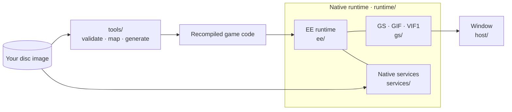

  

<h1 align="center">BT2 Recomp</h1>

Dragon Ball Z: Budokai Tenkaichi 2 · Native Windows x64 recompilation

<strong>SLUS-21441</strong> &nbsp;·&nbsp; <strong>C++20</strong> &nbsp;·&nbsp; <strong>MSVC / CMake</strong> &nbsp;·&nbsp; <strong>Early development</strong>

  <a href="#progress">Progress</a> &nbsp;·&nbsp;
  <a href="#enhancements">Enhancements</a> &nbsp;·&nbsp;
  <a href="#system-requirements">Requirements</a> &nbsp;·&nbsp;
  <a href="#building">Build</a> &nbsp;·&nbsp;
  <a href="#documentation">Documentation</a> &nbsp;·&nbsp;
  <a href="#credits--license">Credits &amp; license</a>

BT2 Recomp is a native Windows port of the PS2 game: its code is recompiled to C++ with PS2Recomp and runs on a small native layer instead of an emulator. Target: the North American release, **SLUS-21441**. Versus battles are playable with a controller at the original's speed, every mode (story, Ultimate Battle Z, the Tournament, the training lessons) runs through without stopping, and HD textures, super-sampling and widescreen are available as settings. Saving and 60 fps battles are in progress.

> **Game files are not included.** You need your own legally obtained copy. This repository holds only project code, tools and documentation.

## Progress
<!-- progress-summary:start -->

| Milestone | Status |
| --- | --- |
| Startup | ✅ Verified — boot, modules answered natively, frame loop; key states match captures of the original |
| Controller and card checks | ✅ Verified — native services; the no-card prompt matches the original |
| Films | 🟢 Operational — logo and opening films with sound, also after a skip |
| Title and menus | 🟢 Operational — title, New Game and all ten main-menu screens; all 15 Ultimate Battle Z courses, Dragon Tournaments and the 21 Ultimate Training lessons run without input |
| Versus battle | 🟢 Operational — 1P vs COM with a controller; CPU vs CPU for characters 0 to 129 on all 16 stages (sampled) |
| Story mode | 🟢 Operational — all 200 parts to their battle's end and all 73 towns without input; not yet played through by the user |
| Audio | 🟢 Operational — music, voices and effects, balanced in both ears; confirmed by the user's listening (the left-only speech fix of 2026-10-20 not yet) |
| Saves | 🔧 Incomplete — the user's save loads; saving not yet tried in the game |
| Enhancements | 🟢 Operational — HD textures (PCSX2 names), super-sampling, widescreen and 60 fps battles in the launcher; HD with 60 fps too slow yet |

**Code:** 11,139 EE functions plus 494 in the `DBZP.BIN` overlay, all compiled natively; the gate's runs and the story sweep interpret nothing · **Gate:** unit tests, Python suites, 32/32 comparisons with the original, the battle run against its baseline.
<!-- progress-summary:end -->

Statuses: ✅ Verified · 🟢 Operational · 🔧 Incomplete · ⛔ Blocking · ⏳ Not Reached.

**Next:** HD textures for the characters' bodies, the final battle sweep. [Full progress](docs/PROG.md) · [What has been checked](docs/progress/VALIDATION.md) · [History](docs/progress/2026-10.md)

## Enhancements

Optional improvements on top of the original game, all off by default.

- **Where:** under **Display** in the launcher, or in the in-game menu (Escape or the PS button). Picture settings apply from the next start.
- **Gameplay is never changed:** fights run at the original speed, with the same physics and results.

### HD textures
Replaces the game's textures with sharp, high-resolution versions from a PCSX2 texture pack. Stages, menus, portraits and text look crisp. Textures are found by the same names PCSX2 uses, so a pack works as it does there; the fighters' bodies are HD when their lighting matches one the pack holds (the game relights them all the time), as in PCSX2.

- **Supported pack:** [Sal9im's AI-upscaled texture pack](https://gbatemp.net/threads/dragon-ball-z-tenkaichi-budokai-2-slus-21441-ai-upscaled-texture-pack.658938/) (not included).
- **Setup:** put the pack's folder (the one holding `replacements`) into `data/textures`, then turn on **HD textures**.
- Uses at most 2 GB of video memory.

### Super-sampling
Smooths jagged edges and adds fine detail by drawing every pixel several times (2x to 16x). From 4x on, the picture is drawn at twice the PS2's resolution (1280 × 896). 16x looks best; 4x suits weaker graphics cards.

### Widescreen
Shows the game in 16:9: fights, cut-scenes and the story map show more to the sides, at the right proportions. Menus and the HUD are stretched to fit.

### Display options
- **Integer scaling:** each game pixel becomes a sharp block of whole screen pixels.
- **Scaling off:** a smooth stretch to the window or the screen.
- **Window size and fullscreen.**

### 60 fps battles
Smoother fights: a picture is drawn between each two of the game's 30 frames per second, from the game's own drawing commands with the camera and the characters halfway. The fight itself still runs exactly as on the PS2, and no delay is added. Something that appears in a frame (a hit flash, smoke) can show one picture early.

### Fast forward
Hold **Tab** (or a controller button of your choice) to speed up films, menus and fights.

### Coming next
- **Sharper scaling:** FSR 1 upscaling with sharpening.
- **Edge smoothing:** a light filter (FXAA or SMAA) for graphics cards that can't afford super-sampling.

## System requirements

Estimated from measurements on one PC (Core i9-10900K, Radeon RX 6800 XT); not yet tried on other hardware. There, a fight uses about half of one processor core and 0.7 GB of memory, and the graphics card needs about 6 ms of the 33 ms a fight frame allows (10 ms with every enhancement on). What matters most is the speed of a single processor core.

| | Minimum (original picture) | With every enhancement (16x super-sampling, HD textures, widescreen) |
| --- | --- | --- |
| **System** | Windows 10 or 11, 64-bit | Windows 10 or 11, 64-bit |
| **Processor** | 4 cores, Intel Core i5-8400 or AMD Ryzen 5 3600 | 6 cores, Intel Core i5-10400 or AMD Ryzen 5 5600 |
| **Memory** | 4 GB | 8 GB |
| **Graphics** | Vulkan graphics card: GeForce GTX 1050 Ti, Radeon RX 570, Intel Arc A380 or similar (older integrated graphics such as Intel UHD 620 are too slow) | GeForce RTX 3060 or Radeon RX 6600 XT (4x super-sampling: GeForce GTX 1660 or Radeon RX 5500 XT) |
| **Video memory** | 2 GB | 4 GB |
| **Storage** | 3.2 GB (your disc image and the program) | 12 GB (with the 8.3 GB texture pack) |

## Building

**Windows 10/11 x64 · Visual Studio 2022 with C++ tools · CMake**

Running the game needs your own disc image: the [build guide](docs/guides/BUILDING.md) prepares the game files, generates the code and builds it. Then put the disc image (`.iso`) into the `data` folder next to `bt2-game.exe` and start it; memory cards live in `saves` beside it. The launcher appears until the game is set up; `bt2-launcher.exe` opens it any time.

## Architecture

The game's code is recompiled ahead of time into native C++. A small handwritten layer provides what it asks of the PS2.

| Part | Role |
| --- | --- |
| **EE runtime** | Memory, kernel, threads, timers, DMA, IPU, VU1 |
| **Native services** | Answer the game's IOP requests on the host (disc, files, controller, memory card, sound, CRI); no IOP code runs |
| **GS** | GPU rendering through paraLLEl-GS (Vulkan); the packets are checked on the processor |
| **Checked boundaries** | Unsupported behavior stops the run instead of guessing; results are compared with captures of the original game |

## Documentation

| Document | Contents |
| --- | --- |
| [Build and test](docs/guides/BUILDING.md) | Host build, game-file preparation, startup probe |
| [Progress](docs/PROG.md) | Measurements, subsystem status, next steps |
| [Implementation plan](docs/project/IMPLEMENTATION_PLAN.md) | Goals, direction and working rules |
| [Runtime layout](docs/guides/RUNTIME_LAYOUT.md) · [Tools](docs/guides/TOOLS.md) | Where code lives; local tooling |
| [Reference architecture](docs/reference/REFERENCE_ARCHITECTURE.md) | Reference projects and how they are used |
| [Content and licenses](docs/project/LEGAL.md) | Game-file policy and dependency licenses |

## AI tools

AI tools are used for coding, investigation and documentation. Changes are checked with automated tests and comparisons against the original game; unverified work is labeled in the progress records.

## Credits & license

Project owner and maintainer: [oric212](https://github.com/oric212).

| Project | Contribution |
| --- | --- |
| [PS2Recomp](https://github.com/ran-j/PS2Recomp) by ran-j and contributors | Static recompiler (GPL-3.0) |
| [BT3-Recomp](https://github.com/z3xox/BT3-Recomp) and [Tenkaichi3Decomp](https://github.com/z3xox/Tenkaichi3Decomp) by z3xox and contributors | Architecture and tooling references; native-layer approach |
| [paraLLEl-GS](https://github.com/Arntzen-Software/parallel-gs) by Arntzen Software | GPU GS renderer (LGPL-3.0) |
| [PCSX2](https://github.com/PCSX2/pcsx2) · [PS2SDK](https://github.com/ps2dev/ps2sdk) | Behavior references and original-game comparison captures |
| [Ghidra](https://github.com/NationalSecurityAgency/ghidra) | Function discovery |
| [xxHash](https://github.com/Cyan4973/xxHash) by Yann Collet | XXH3, for PCSX2-compatible texture names (BSD-2-Clause) |
| [PCSX2 patches](https://github.com/PCSX2/pcsx2_patches) | The widescreen patch's values for SLUS-21441 (Widescreen 16:9) |
| [Sal9im](https://gbatemp.net/threads/dragon-ball-z-tenkaichi-budokai-2-slus-21441-ai-upscaled-texture-pack.658938/) | The HD texture pack the port supports: [Dragon Ball Z: Budokai Tenkaichi 2 (SLUS-21441) AI Upscaled Texture Pack](https://gbatemp.net/threads/dragon-ball-z-tenkaichi-budokai-2-slus-21441-ai-upscaled-texture-pack.658938/) on GBAtemp (not included) |

### License and game ownership

This repository is **GPL-3.0** (see [LICENSE](LICENSE)). *Dragon Ball Z: Budokai Tenkaichi 2* © Spike / Bandai Namco. This project is not affiliated with or endorsed by them; it exists for preservation and interoperability and distributes no game content. Game code is recompiled locally during the generation/build workflow from files supplied from the user's own disc image; proprietary-derived generated code is not distributed in this repository.