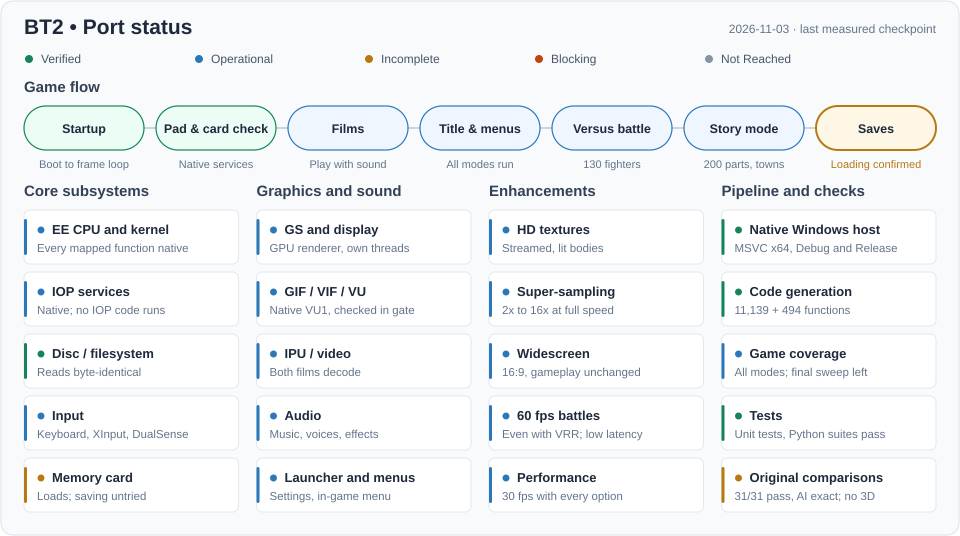
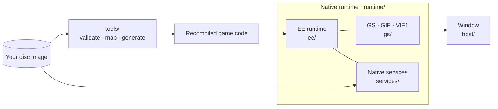

  

<h1 align="center">BT2 Recomp</h1>

Dragon Ball Z: Budokai Tenkaichi 2 · Native Windows x64 recompilation

<strong>SLUS-21441</strong> &nbsp;·&nbsp; <strong>C++20</strong> &nbsp;·&nbsp; <strong>MSVC / CMake</strong> &nbsp;·&nbsp; <strong>Early development</strong>

  <a href="#progress">Progress</a> &nbsp;·&nbsp;
  <a href="#enhancements">Enhancements</a> &nbsp;·&nbsp;
  <a href="#system-requirements">Requirements</a> &nbsp;·&nbsp;
  <a href="#building">Build</a> &nbsp;·&nbsp;
  <a href="#documentation">Documentation</a> &nbsp;·&nbsp;
  <a href="#credits--license">Credits &amp; license</a>

BT2 Recomp is a native Windows port of the PS2 game: its code is recompiled to C++ with PS2Recomp and runs on a small native layer instead of an emulator. Target: the North American release, **SLUS-21441**.

Every mode runs through: versus battles are playable with a controller at the original's speed, and the story, Ultimate Battle Z, the tournaments and the training lessons run without stopping. The enemy AI computes exactly what it does in PCSX2 at the calls compared. Optional enhancements: HD textures, super-sampling, widescreen, 60 fps battles and fast loading. Saving to a memory card is not yet confirmed.

> **Game files are not included.** You need your own legally obtained copy. This repository holds only project code, tools and documentation.

## Progress
<!-- progress-summary:start -->

| Milestone | Status |
| --- | --- |
| Startup | ✅ Verified — boot to the frame loop; key states match captures of the original |
| Controller and card checks | ✅ Verified — native services; the no-card prompt matches the original |
| Films | 🟢 Operational — logo and opening films with sound |
| Title and menus | 🟢 Operational — every main-menu mode; all Ultimate Battle Z courses, tournaments and training lessons run without input |
| Versus battle | 🟢 Operational — playable with a controller; CPU vs CPU sampled over all 130 fighters and 16 stages; the enemy AI matches PCSX2 exactly at the calls compared |
| Story mode | 🟢 Operational — all 200 parts and 73 towns run without input; not yet played through |
| Audio | 🟢 Operational — music, voices and effects; confirmed by listening (the speech-balance fix of 2026-10-20 not yet) |
| Saves | 🔧 Incomplete — loading confirmed; saving not yet tried in the game |
| Enhancements | 🟢 Operational — HD textures, super-sampling to 16x, widescreen, 60 fps battles, fast loading, beam struggles by buttons; full speed with all of them on the test PC |

**Code:** 11,139 EE functions plus 494 in the `DBZP.BIN` overlay, all compiled natively; the gate's runs and the story sweep interpret nothing · **Gate:** unit tests, Python suites, 31/31 comparisons with the original, the battle run against its baseline.
<!-- progress-summary:end -->

Statuses: ✅ Verified · 🟢 Operational · 🔧 Incomplete · ⛔ Blocking · ⏳ Not Reached.

**Now:** smoother, lighter 60 fps battles. **Then:** an edge filter, play-testing of saves and enhancements, the final battle sweep. [Full progress](docs/PROG.md) · [What has been checked](docs/progress/VALIDATION.md) · [History](docs/progress/2026-11.md)

## Enhancements

All optional, set on the **Enhancements** screen of the launcher or the in-game menu (Escape or the PS button); they apply from the next start. **Gameplay never changes:** fights run at the original speed with the same physics, and an enhancement the PC cannot keep up with gives way instead of slowing the game.

| Enhancement | What it does |
| --- | --- |
| **HD textures** | Draws the game with a PCSX2 texture pack's replacements, found by PCSX2's names. Menus are almost all HD; in fights the fighters' bodies stay HD through the game's relighting. Supported pack: [Sal9im's AI-upscaled pack](https://gbatemp.net/threads/dragon-ball-z-tenkaichi-budokai-2-slus-21441-ai-upscaled-texture-pack.658938/) (not included); put its folder into `data/textures`. |
| **Super-sampling** | 2x to 16x samples per pixel; from 4x the picture is twice the PS2's resolution. 4x suits weaker graphics cards. |
| **Widescreen** | 16:9 fights, cut-scenes and story map; menus and the HUD stretched. |
| **60 fps battles** | A picture drawn between each two of the game's 30 frames; the fight itself runs as on the PS2. Turns itself off if the processor falls behind. Being refined: it adds some delay to the picture. |
| **Fast loading** | Shorter loading screens; on by default. |
| **Beam struggles by buttons** | Push in a beam struggle by pressing Square instead of turning the stick; on by default. |
| **Display** | Integer scaling or a smooth stretch, window size, fullscreen. **Tab** (or a controller button) fast-forwards. |

## System requirements

Estimates from one PC (Intel Core i9-10900K, AMD Radeon RX 6800 XT): other processors were stood in for by limiting the game's cores, and other graphics cards scaled from its timings, not tested. One core's speed matters most; super-sampling is the setting to lower on a weaker graphics card.

| | Minimum (original picture) | Recommended (every enhancement: 16x super-sampling, HD textures, widescreen, 60 fps battles) |
| --- | --- | --- |
| **System** | Windows 10 or 11, 64-bit | Windows 10 or 11, 64-bit |
| **Processor** | 4 cores, for example Intel Core i5-6500 or AMD Ryzen 3 1200 | 4 cores with 8 threads, for example Intel Core i7-7700, Core i3-12100 or AMD Ryzen 5 2600 |
| **Memory** | 4 GB | 8 GB |
| **Graphics** | Vulkan graphics card: GeForce GTX 1050 Ti, Radeon RX 570, Intel Arc A380 or similar (older integrated graphics such as Intel UHD 620 are too slow) | GeForce RTX 3070 or Radeon RX 6700 XT. With 4x super-sampling instead of 16x: GeForce RTX 3060 or Radeon RX 6600 XT |
| **Video memory** | 2 GB | 4 GB |
| **Storage** | 3.2 GB (your disc image and the program) | 12 GB (with the 8.3 GB texture pack) |

## Building

**Windows 10/11 x64 · Visual Studio 2022 with C++ tools · CMake**

Running the game needs your own disc image: the [build guide](docs/guides/BUILDING.md) prepares the game files, generates the code and builds it. Then put the disc image (`.iso`) into the `data` folder next to `bt2-game.exe` and start it; memory cards live in `saves` beside it. The launcher appears until the game is set up; `bt2-launcher.exe` opens it any time.

## Architecture

The game's code is recompiled ahead of time into native C++. A small handwritten layer provides what it asks of the PS2.

| Part | Role |
| --- | --- |
| **EE runtime** | Memory, kernel, threads, timers, DMA, IPU, VU1 |
| **Native services** | Answer the game's IOP requests on the host (disc, files, controller, memory card, sound, CRI); no IOP code runs |
| **GS** | GPU rendering through paraLLEl-GS (Vulkan); the packets are checked on the processor |
| **Checked boundaries** | Unsupported behavior stops the run instead of guessing; results are compared with captures of the original game |

## Documentation

| Document | Contents |
| --- | --- |
| [Build and test](docs/guides/BUILDING.md) | Host build, game-file preparation, startup probe |
| [Progress](docs/PROG.md) | Measurements, subsystem status, next steps |
| [Implementation plan](docs/project/IMPLEMENTATION_PLAN.md) | Goals, direction and working rules |
| [Runtime layout](docs/guides/RUNTIME_LAYOUT.md) · [Tools](docs/guides/TOOLS.md) | Where code lives; local tooling |
| [Reference architecture](docs/reference/REFERENCE_ARCHITECTURE.md) | Reference projects and how they are used |
| [Content and licenses](docs/project/LEGAL.md) | Game-file policy and dependency licenses |

## AI tools

AI tools are used for coding, investigation and documentation. Changes are checked with automated tests and comparisons against the original game; unverified work is labeled in the progress records.

## Credits & license

Project owner and maintainer: [oric212](https://github.com/oric212).

| Project | Contribution |
| --- | --- |
| [PS2Recomp](https://github.com/ran-j/PS2Recomp) by ran-j and contributors | Static recompiler (GPL-3.0) |
| [BT3-Recomp](https://github.com/z3xox/BT3-Recomp) and [Tenkaichi3Decomp](https://github.com/z3xox/Tenkaichi3Decomp) by z3xox and contributors | Architecture and tooling references; native-layer approach |
| [paraLLEl-GS](https://github.com/Arntzen-Software/parallel-gs) by Arntzen Software | GPU GS renderer (LGPL-3.0) |
| [PCSX2](https://github.com/PCSX2/pcsx2) · [PS2SDK](https://github.com/ps2dev/ps2sdk) | Behavior references and original-game comparison captures |
| [Ghidra](https://github.com/NationalSecurityAgency/ghidra) | Function discovery |
| [xxHash](https://github.com/Cyan4973/xxHash) by Yann Collet | XXH3, for PCSX2-compatible texture names (BSD-2-Clause) |
| [PCSX2 patches](https://github.com/PCSX2/pcsx2_patches) | The widescreen patch's values for SLUS-21441 (Widescreen 16:9) |
| [Sal9im](https://gbatemp.net/threads/dragon-ball-z-tenkaichi-budokai-2-slus-21441-ai-upscaled-texture-pack.658938/) | The HD texture pack the port supports: [Dragon Ball Z: Budokai Tenkaichi 2 (SLUS-21441) AI Upscaled Texture Pack](https://gbatemp.net/threads/dragon-ball-z-tenkaichi-budokai-2-slus-21441-ai-upscaled-texture-pack.658938/) on GBAtemp (not included) |

### License and game ownership

This repository is **GPL-3.0** (see [LICENSE](LICENSE)). *Dragon Ball Z: Budokai Tenkaichi 2* © Spike / Bandai Namco. This project is not affiliated with or endorsed by them; it exists for preservation and interoperability and distributes no game content. Game code is recompiled locally during the generation/build workflow from files supplied from the user's own disc image; proprietary-derived generated code is not distributed in this repository.