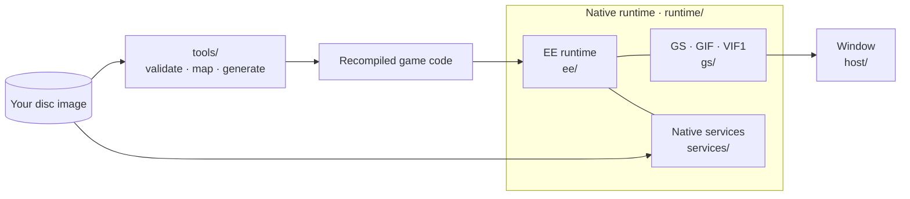

<p align="center">
  
</p>

<h1 align="center">BT2 Recomp</h1>
<p align="center">Dragon Ball Z: Budokai Tenkaichi 2 · Native Windows x64 recompilation</p>
<p align="center"><strong>SLUS-21441</strong> &nbsp;·&nbsp; <strong>C++20</strong> &nbsp;·&nbsp; <strong>MSVC / CMake</strong> &nbsp;·&nbsp; <strong>Early development</strong></p>

<p align="center">
  <a href="#progress">Progress</a> &nbsp;·&nbsp;
  <a href="#building">Build</a> &nbsp;·&nbsp;
  <a href="#documentation">Documentation</a> &nbsp;·&nbsp;
  <a href="#credits--license">Credits &amp; license</a>
</p>

BT2 Recomp is a native Windows port of the PS2 game: its code is recompiled to C++ with PS2Recomp and runs on a small native layer instead of an emulator. Target: the North American release, **SLUS-21441**. First gameplay goal: a **playable versus battle**.

> **Game files are not included.** You need your own legally obtained copy. This repository holds only project code, tools and documentation.

## Progress
<!-- progress-summary:start -->


| Functional milestone | Status |
| --- | --- |
| Boot | ✅ Verified — game entry, kernel services, IOP reset and module loading (answered natively) |
| Main frame loop | ✅ Verified — key startup states match original captures |
| First presented frame | ✅ Verified — 1,000 frames in the gate run; 9,000 (the budget) in the long Release run |
| Controller check | ✅ Verified — passed with the native controller service |
| Memory card check | ✅ Verified — without a card the prompt is answered by scripted input (compared with the original); with a card folder in the slot the game reads the save and shows no prompt (the user's play) |
| Opening movie | 🟢 Operational — the logo movie and the opening movie play to the end with their sound, from any start moment and after the first one is skipped (decoded natively); frames match an independent decoder at spot checks |
| Title screen | 🟢 Operational — the title screen, its option list and the New Game dialogues render and respond to scripted input (the user confirms the pictures) |
| Demo fight (no input) | 🟢 Operational — two CPU-vs-CPU demo fights render in 3D on the GPU renderer and play to their end (the user confirmed the frames; not compared with the original by capture); their sound has not been listened to |
| Menus | 🟢 Operational — main menu (all nine entries scroll), Dueling menu, character selection and map selection render and respond to scripted input (the user confirms the pictures); only the path to a 1P-vs-COM duel has been entered |
| Versus battle | 🟢 Operational — a 1P-vs-COM duel loads and runs with a controller or scripted input, with music and sound effects; frames confirmed by the user; GPU renderer; special moves and ultimates stopped the game at unmapped code, which is mapped now and waits for the user's test; not compared with the original by capture |
| Audio | 🟢 Operational — volumes for the whole mix, music and effects in the launcher and the in-game menu; stream audio (movies, music) and sound effects, including looping and stopped ones, are mixed, written to a WAV file and played on the audio device (`--sound`), which holds the run at the game's speed; the user listened to a WAV of menus and a fight and confirmed it; stream level, channel order and timing match a PCSX2 recording for the boot movies; live sound not yet heard by the user, gaps expected in fights (slower than real time) |
| Saves | 🔧 Incomplete — the user's 100% save on a memory card folder loads (confirmed by the user); writing saves is implemented and unit-tested, not yet tried in the game; a new empty card is made when none is chosen |

**Measured 2026-10-13:** runtime coverage **2,007 EE functions entered / 1,998 completed** in the verified run (4,936 / 4,927 in the long run through a battle) · static coverage **11,122 EE functions mapped and generated** · verification **18/18 tests, 42 of 46 original comparisons passing** at this checkpoint.
<!-- progress-summary:end -->

Statuses: ✅ Verified · 🟢 Operational · 🔧 Incomplete · ⛔ Blocking · ⏳ Not Reached.

**Next:** decode the opening movie (native IPU), then the title screen and menus. [Full progress](docs/PROG.md) · [Current handoff](docs/progress/ACTIVE_PASS.md) · [History](docs/progress/2026-10.md)

## Building

**Windows 10/11 x64 · Visual Studio 2022 with C++ tools · CMake**

```powershell
cmake -S . -B build
cmake --build build --config Debug
.\build\Debug\bt2-port.exe
```

This builds the foundation host only. Running the game code needs your own disc image and the local preparation steps in the [build guide](docs/guides/BUILDING.md).

## Architecture

The game's code is recompiled ahead of time into native C++. A small handwritten layer provides what it asks of the PS2.



| Part | Role |
| --- | --- |
| **EE runtime** | Memory, kernel, threads, timers, DMA, IPU |
| **Native services** | Answer the game's IOP requests on the host (disc, files, controller, memory card, sound, CRI); no IOP code runs |
| **GS** | GPU rendering through paraLLEl-GS (Vulkan), with a CPU renderer as fallback and test reference |
| **Checked boundaries** | Unsupported behavior stops the run instead of guessing; results are compared with captures of the original game |

## Documentation

| Document | Contents |
| --- | --- |
| [Build and test](docs/guides/BUILDING.md) | Host build, game-file preparation, startup probe |
| [Progress](docs/PROG.md) | Measurements, subsystem status, next steps |
| [Implementation plan](docs/project/IMPLEMENTATION_PLAN.md) | Goals, direction and working rules |
| [Runtime layout](docs/guides/RUNTIME_LAYOUT.md) · [Tools](docs/guides/TOOLS.md) | Where code lives; local tooling |
| [Reference architecture](docs/reference/REFERENCE_ARCHITECTURE.md) | Reference projects and how they are used |
| [Content and licenses](docs/project/LEGAL.md) | Game-file policy and dependency licenses |

## AI tools

AI tools are used for coding, investigation and documentation. Changes are checked with automated tests and comparisons against the original game; unverified work is labeled in the progress records.

## Credits & license

Project owner and maintainer: [oric212](https://github.com/oric212).

| Project | Contribution |
| --- | --- |
| [PS2Recomp](https://github.com/ran-j/PS2Recomp) by ran-j and contributors | Static recompiler (GPL-3.0) |
| [BT3-Recomp](https://github.com/z3xox/BT3-Recomp) and [Tenkaichi3Decomp](https://github.com/z3xox/Tenkaichi3Decomp) by z3xox and contributors | Architecture and tooling references; native-layer approach |
| [paraLLEl-GS](https://github.com/Arntzen-Software/parallel-gs) by Arntzen Software | GPU GS renderer (LGPL-3.0) |
| [PCSX2](https://github.com/PCSX2/pcsx2) · [PS2SDK](https://github.com/ps2dev/ps2sdk) | Behavior references and original-game comparison captures |
| [Ghidra](https://github.com/NationalSecurityAgency/ghidra) | Function discovery |

### License and game ownership

This repository is **GPL-3.0** (see [LICENSE](LICENSE)). *Dragon Ball Z: Budokai Tenkaichi 2* © Spike / Bandai Namco. This project is not affiliated with or endorsed by them; it exists for preservation and interoperability and distributes no game content. Game code is recompiled locally during the generation/build workflow from files supplied from the user's own disc image; proprietary-derived generated code is not distributed in this repository.