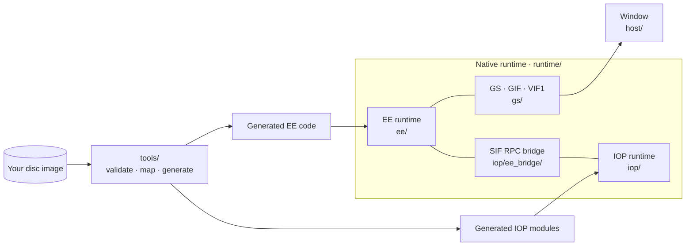

<p align="center">
  
</p>

<h1 align="center">BT2 Recomp</h1>
<p align="center">Dragon Ball Z: Budokai Tenkaichi 2 · Native Windows x64 recompilation</p>
<p align="center"><strong>SLUS-21441</strong> &nbsp;·&nbsp; <strong>C++20</strong> &nbsp;·&nbsp; <strong>MSVC / CMake</strong> &nbsp;·&nbsp; <strong>Early development</strong></p>

<p align="center">
  <a href="#progress">Progress</a> &nbsp;·&nbsp;
  <a href="#building">Build</a> &nbsp;·&nbsp;
  <a href="#documentation">Documentation</a> &nbsp;·&nbsp;
  <a href="docs/progress/ACTIVE_PASS.md">Active work</a> &nbsp;·&nbsp;
  <a href="#credits--license">Credits &amp; license</a>
</p>

BT2 Recomp aims to run the original PS2 game logic natively on Windows 10/11 using PS2Recomp and a custom compatibility runtime. The initial target is the North American release, **SLUS-21441**; the first major gameplay goal is a **playable versus battle**.

> **Game files are not included.** You must provide the game files from your own legally obtained copy to build and test the project. This repository contains only project code, tools and documentation; it does not distribute game disc images, executables, assets or generated game code.

## Progress
<!-- progress-summary:start -->


**Where the port is:** the recompiled game boots, completes its startup and runs its own frame loop. It has presented **650 frames** in a live window: the controller check and the memory card screens, up to the transition into the opening movie. It then prepares the movie and stops at the next unimplemented hardware feature. Playing the movie needs MPEG decoding, which is not implemented yet.

| Milestone | Status |
| --- | --- |
| Recompilation pipeline (validation, map, code generation, native host) | ✅ Verified |
| Startup: kernel services, original IOP modules, disc reads, threads | ✅ Verified — reaches the main frame loop; key states match original captures |
| First presented frame | ✅ Verified — boot screens drawn by the GS model and shown in a live window |
| Controller and memory card checks | ✅ Verified — emulated DualShock 2; no card mounted, prompt answered by scripted input |
| Opening movie | 🔧 In progress — decoder setup done; graphics DMA chain mode next, then MPEG decoding |
| Title screen and attract-mode demo fight | ⏳ Pending |
| Menus and playable versus battle | ⏳ Pending |
| Audio output | ⏳ Pending — sound driver set up; no sound produced |
| Memory card saves | ⏳ Pending |

**Last measured, 2026-10-08:** **1,254 game functions entered / 1,243 completed**, **650 presented frames**, **1,034 logical VBlanks**, **186 original IOP disc reads**, **43 CRI sound calls**, **77 memory card queries**.
<!-- progress-summary:end -->

[Detailed measurements](docs/PROG.md) · [Unfinished-pass handoff](docs/progress/ACTIVE_PASS.md) · [Progress history](docs/progress/2026-10.md)

## Building

**Windows 10/11 x64 · Visual Studio 2022 with C++ tools · CMake**

```powershell
cmake -S . -B build
cmake --build build --config Debug
.\build\Debug\bt2-port.exe
```

The foundation host prints its startup message. Before recompiling or testing BT2, prepare your own North American SLUS-21441 disc image, extract its original executable and boot configuration, and validate them using the [game-file preparation steps](docs/BUILDING.md#3-prepare-your-own-game-files-before-recompilation). Testing generated startup uses a separate developer probe with locally prepared inputs and your ISO. See [building and startup tests](docs/BUILDING.md) for setup and commands. The game is not yet playable.

## Architecture

The game's code is recompiled ahead of time into native C++. A small handwritten runtime stands in for the PS2 hardware.



| Part | Role |
| --- | --- |
| **EE runtime** | Memory, kernel, threads, timers, DMA |
| **IOP runtime** | Runs the game's own IOP modules: SPU2, pad, memory card, disc |
| **GS** | Software rasterizer for the game's draw packets |
| **Checked boundaries** | Unsupported behavior stops the run instead of guessing; results are compared with captures of the original game |

Details: [runtime layout](docs/RUNTIME_LAYOUT.md) · [reference architecture](docs/REFERENCE_ARCHITECTURE.md)

## Repository layout

| Directory | Purpose |
| --- | --- |
| `runtime/` | Native host, compatibility services and execution probes ([layout](docs/RUNTIME_LAYOUT.md)) |
| `game/` | Handwritten BT2 integration; generated game code is ignored |
| `config/` | Recompiler configuration, layout and pinned tool versions |
| `tools/` | Validation, generation, capture and progress tooling |
| `docs/` | Plans, evidence, build instructions and progress history |
| `external/` | Dependency integration notes |

Dependency checkouts, generated translations and analysis output live in ignored local directories. The workflow follows actual execution blockers; unknown functions retain neutral names.

## Documentation

| Start here | Details |
| --- | --- |
| [Build and test](docs/BUILDING.md) | Host build, local prerequisites and startup probe |
| [Current progress](docs/PROG.md) | Verified measurements, blocker and milestones |
| [Active pass](docs/progress/ACTIVE_PASS.md) | Pending changes, missing checks and resume steps |
| [Implementation plan](docs/IMPLEMENTATION_PLAN.md) | Goals and subsystem-scale working rules |
| [Reference architecture](docs/REFERENCE_ARCHITECTURE.md) | Reference projects and adaptation guidance |
| [Tools and evidence](docs/TOOLS.md) | Local tooling; [reverse-engineering notes](docs/REVERSE_ENGINEERING.md) |
| [History](docs/progress/2026-10.md) | Detailed pass records; [tracking rules](docs/PROGRESS_TRACKING.md) |
| [Content and licenses](docs/LEGAL.md) | Local game-file policy and dependency licenses |
## AI tools and manual testing

Development of this project involves AI tools for coding, investigation and documentation. AI-assisted changes will be reviewed and tested manually, alongside automated tests and comparisons against the original game's behavior. Unverified work is labeled in the progress records; use of AI does not establish correctness or mean that all current changes have passed manual testing.

## Credits & license

### Project

- [oric212](https://github.com/oric212) — project owner and maintainer.

### Tools and references

| Project | Contribution |
| --- | --- |
| [PS2Recomp](https://github.com/ran-j/PS2Recomp) by ran-j and contributors | Static recompiler (GPL-3.0); its `ps2xRuntime` is the runtime architecture reference |
| [BT3-Recomp](https://github.com/z3xox/BT3-Recomp) by z3xox and contributors | Primary architectural and tooling reference |
| [Chronicle](https://github.com/TheMoonPeople/Chronicle) by TheMoonPeople and contributors | Reverse-engineering and progress-reporting reference |
| [PS2SDK](https://github.com/ps2dev/ps2sdk) by the ps2dev community | Behavioral reference for kernel, SIF/RPC and IOP modules |
| [PCSX2](https://github.com/PCSX2/pcsx2) | Hardware behavior reference and original-game comparison captures |
| [Play!](https://github.com/jpd002/Play-) by jpd002 and contributors | Kernel/HLE behavior reference |
| [Ghidra](https://github.com/NationalSecurityAgency/ghidra) | Function discovery and reverse engineering |

Libraries used by the toolchain: [ELFIO](https://github.com/serge1/ELFIO), [toml11](https://github.com/ToruNiina/toml11), [fmt](https://github.com/fmtlib/fmt), [libdwarf](https://github.com/davea42/libdwarf-code), [Rabbitizer](https://github.com/Decompollaborate/rabbitizer) and [nlohmann/json](https://github.com/nlohmann/json).

Reference projects inform architecture and investigation; BT2-specific behavior is validated against local evidence. Dependency versions and licenses are recorded in [the content and license documentation](docs/LEGAL.md).

### License and game ownership

This repository is **GPL-3.0** (see [LICENSE](LICENSE)). *Dragon Ball Z: Budokai Tenkaichi 2* © Spike / Bandai Namco. This project is not affiliated with or endorsed by them; it exists for preservation and interoperability and distributes no game content. Game code is recompiled locally during the generation/build workflow from files supplied from the user's own disc image; proprietary-derived generated code is not distributed in this repository.