# BT2 Native Recompilation Project

A native Windows x64 port of Dragon Ball Z: Budokai Tenkaichi 2 using static recompilation of the original PS2 game logic and a custom PS2 compatibility runtime. The initial target is the North American release, SLUS-21441. This is a recompilation project, not a ground-up remake.

## Current status

<!-- progress-summary:start -->
**Verified checkpoint: native startup probe; complete startup remains unfinished.**
Last measured: **2026-10-06**, using the local game ISO and prepared startup inputs.

| Area | Verified result |
| --- | --- |
| EE execution | **291 distinct entries entered / 286 completed**; kernel **2 / 2** |
| Runtime activity | **3,855 calls / 3,848 returns**; **61,612 IOP instructions** |
| Sound setup | **37 CRI calls**, **six IOP heap allocations**; first AutoDMA half pending |
| Disc access | Directory-sector read and initial metadata lookups work |
| Graphics | Two startup clears consumed; **no presented game frame** |
| Current blocker | Worker `ReferThreadStatus`: selector `0x30`, EE PC `0x32EB68` |
| Active work | Worker status/start/priority changes **implemented locally, not yet verified** |
| Next gate | Finish worker tests/build, rerun startup, compare captures and record the new boundary |

Counts describe observed execution, not fully restored gameplay functions or a percentage of completion. Audio playback, complete startup and gameplay are not verified.

```mermaid
flowchart LR
    A["Local validation<br/>Verified"] --> B["Map and generation<br/>Working; provisional map"]
    B --> C["Native startup execution<br/>Verified to checked boundary"]
    C --> D["Worker scheduling<br/>Active; latest changes unverified"]
    D --> E["Archive payload loading<br/>Not verified"]
    E --> F["Game draw and presentation<br/>No presented frame"]
    F --> G["Title/menu and battle<br/>Not reached"]
    classDef verified fill:#173c2c,stroke:#4ade80,color:#fff
    classDef active fill:#493b16,stroke:#fbbf24,color:#fff
    classDef future fill:#242b36,stroke:#94a3b8,color:#fff
    class A,B,C verified
    class D active
    class E,F,G future
```

This is the main startup path, not a strict dependency graph; audio and other runtime services develop alongside it.

| Subsystem | Evidence / measurement | Status |
| --- | --- | --- |
| Mapping / generation | 8,584 provisional EE entries; 8,587 raw generated files; 221 extra entries selected | Tooling working; map remains provisional |
| IOP execution | 213 physical entry targets; 14 module-load paths / 13 resident modules | Bounded execution verified |
| EE memory / threads | Four startup pools; one child ready but unexecuted | Scheduling incomplete |
| Disc loading | One two-sector read; original completion callback; six metadata lookups/transfers | Initial metadata verified; archive payload pending |
| Memory cards | Six DMA pairs; five timed FIFO probes | Absent-card path verified; mounted filesystem pending |
| Audio transport | First owned 2,048-byte AutoDMA half programmed | Consumption / IRQ / native playback unverified |
| GS sink | Three packets; two startup draws; 573,440 sprite pixels | Startup clears verified; presentation absent |
| End-to-end game | No title screen, input-driven battle or completed match | Not reached |

**Change from the preceding measured checkpoint:** CRI calls **35 → 37**, heaps **4 → 6**, EE call events **3,415 → 3,855**, IOP instructions **61,054 → 61,612**. The older **111 / 107** distinct count is from an earlier checkpoint; it is not a same-pass delta.
<!-- progress-summary:end -->

[Current progress](docs/PROG.md) · [Active-pass handoff](docs/progress/ACTIVE_PASS.md) · [Detailed history](docs/progress/2026-10.md) · [Tracking rules](docs/PROGRESS_TRACKING.md)

The retail revision is confirmed against Redump disc checksums and an embedded-executable match. The host builds with CMake and MSVC; startup testing requires locally prepared ignored inputs. See [build and startup test instructions](docs/BUILDING.md).

Game files are not included. Users supply files from their own copy locally under ignored `game_data/` or `rom/`. Never commit proprietary content or generated code derived from the retail executable.

See [build instructions](docs/BUILDING.md), [the implementation plan](docs/IMPLEMENTATION_PLAN.md), [current progress](docs/PROG.md), [detailed history](docs/progress/2026-10.md), [content and license rules](docs/LEGAL.md), [local tools](docs/TOOLS.md), and [reverse-engineering notes](docs/REVERSE_ENGINEERING.md).

## Layout

- `runtime/`: native host and future PS2 compatibility code.
- `game/`: handwritten BT2 integration; proprietary-derived output belongs in ignored `game/generated/`.
- `config/`: shared configuration examples when needed.
- `tools/`: development tools, including preliminary local executable verification.
- `external/`: dependency integration notes; no dependencies are bundled yet.
- `docs/`: goals, build instructions, progress, and evidence records.

Pinned PS2Recomp tools build separately from the host. Dependency checkouts stay under ignored `work/`; versions are in `config/ps2recomp.lock.json`. The workflow uses a provisional neutral function map and advances through generation, builds, execution and blocker diagnostics. Keep local game paths under ignored `game_data/` or `rom/`.

Ghidra with R5900 support is installed under `D:\Cs\Cpp\tools`. Local analysis exports provisional neutral function candidates under ignored `work/ghidra/`; manual review focuses on paths that block generated execution.

Run `python tools/ps2recomp/run_pipeline.py` after local Ghidra export and tool setup; use `--reuse-generated` to verify and reuse generated output. See [reference architecture](docs/REFERENCE_ARCHITECTURE.md). Passing probes establish execution to checked boundaries; the game has not booted.
