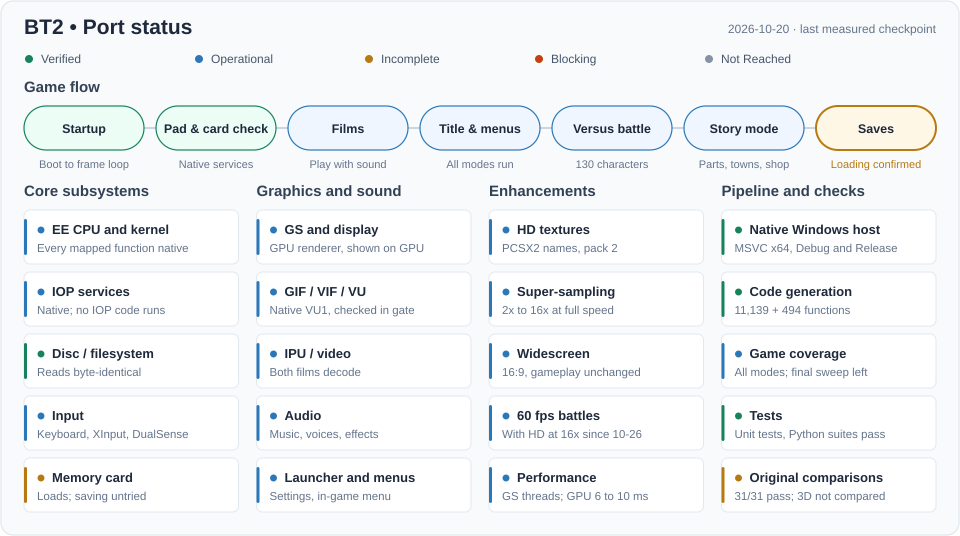

# Current progress

Target: *Dragon Ball Z: Budokai Tenkaichi 2* (SLUS-21441), a native Windows x64 port: recompiled game code on a minimal native layer ([implementation plan](project/IMPLEMENTATION_PLAN.md)). What has been checked, and how: [VALIDATION.md](progress/VALIDATION.md).

<!-- progress-summary:start -->

| Milestone | Status |
| --- | --- |
| Startup | ✅ Verified — boot, modules answered natively, frame loop; key states match captures of the original |
| Controller and card checks | ✅ Verified — native services; the no-card prompt matches the original |
| Films | 🟢 Operational — logo and opening films with sound, also after a skip |
| Title and menus | 🟢 Operational — title, New Game and all ten main-menu screens; all 15 Ultimate Battle Z courses, Dragon Tournaments and the 21 Ultimate Training lessons run without input |
| Versus battle | 🟢 Operational — 1P vs COM with a controller; CPU vs CPU for characters 0 to 129 on all 16 stages (sampled) |
| Story mode | 🟢 Operational — all 200 parts to their battle's end and all 73 towns without input; not yet played through by the user |
| Audio | 🟢 Operational — music, voices and effects, balanced in both ears; confirmed by the user's listening (the left-only speech fix of 2026-10-20 not yet) |
| Saves | 🔧 Incomplete — the user's save loads; saving not yet tried in the game |
| Enhancements | 🟢 Operational — HD textures (PCSX2 names), super-sampling, widescreen and 60 fps battles in the launcher; HD with 60 fps too slow yet |

**Code:** 11,139 EE functions plus 494 in the `DBZP.BIN` overlay, all compiled natively; the gate's runs and the story sweep interpret nothing · **Gate:** unit tests, Python suites, 32/32 comparisons with the original, the battle run against its baseline.
<!-- progress-summary:end -->

Status: ✅ Verified · 🟢 Operational · 🔧 Incomplete · ⛔ Blocking · ⏳ Not Reached ([definitions](project/PROGRESS_TRACKING.md)).

## Measurements

One PC (Core i9-10900K, Radeon RX 6800 XT), Release build, a paced versus fight in the window ([performance plan](plans/ee/PERFORMANCE_PLAN.md)).

| Item | Value |
| --- | --- |
| Fight | 30 pictures per second (the original's rate); work per picture 15 to 21 ms of 33, also with every enhancement |
| Processor and memory | About half of one core; 0.7 GB (0.85 GB with every enhancement) |
| Graphics card | 6 ms per frame plain, 10 ms with 16x super-sampling, HD textures and widescreen; 0.8 to 1.2 GB of video memory |
| Functions entered | 3,732 in the gate's battle run (5,100 frames); 3,500 to 3,800 per CPU-vs-CPU battle |

## Subsystems

| Subsystem | Status | Scope |
| --- | --- | --- |
| EE CPU and kernel | 🟢 Operational | Every mapped function compiled; unmapped code through a logged interpreter bridge, compiled at the next build; threads, semaphores, interrupts |
| IOP services | 🟢 Operational | Native disc, file, heap, controller, memory card, sound and CRI services; no IOP code runs ([plan](plans/iop/NATIVE_SERVICES_PLAN.md)) |
| GS and display | 🟢 Operational | paraLLEl-GS draws every screen, the only renderer; the picture goes to the window on the GPU |
| GIF / VIF / VU | 🟢 Operational | DMA as the game uses it; VU1 programs native (the heaviest hand-written), checked in the gate |
| IPU / video | 🟢 Operational | Both films decode through the game's Sofdec library |
| Audio | 🟢 Operational | ADX streams and a native effects sampler, 48 kHz stereo ([plan](plans/sound/SOUND_OUTPUT_PLAN.md)) |
| Input | 🟢 Operational | Keyboard, XInput and DualSense; mapping in the launcher and the in-game menu |
| Memory card | 🔧 Incomplete | A host folder per card; loading confirmed; saving untried ([plan](plans/memory-card/MEMORY_CARD_PLAN.md)) |
| Disc / filesystem | ✅ Verified | ISO reads; archive table and overlay byte-identical to the original |

Proprietary inputs, generated code, captures and rendered frames stay local and ignored.

## Next steps

Details in the [handoff](progress/ACTIVE_PASS.md):

1. **HD textures with 60 fps together** (each alone runs at full speed): the game's thread needs 33 to 40 ms a flip with both; then the user's look at the reworked HD textures and 60 fps.
2. **Picture:** FSR 1 scaling with sharpening, an edge filter ([image quality](plans/graphics/IMAGE_QUALITY_PLAN.md)); 60 fps battles: things that appear in a frame show one picture early ([plan](plans/graphics/HIGH_FRAME_RATE_PLAN.md)); HD textures: the fighters with the pack's detail on the game's colours, not yet seen in play ([HD textures](plans/graphics/HD_TEXTURES_PLAN.md)).
3. **The user's tests:** saving, the enhancements in play, the sound fix, fast forward; the play test fixes of 2026-10-21 (in-game menu freeze, input lag, pulsing lines in a stretched picture, integer scaling with widescreen); 60 fps battles in play.
4. **Final validation:** the exhaustive battle sweep, then the runtime generalization plan's groups 4 to 6.

## Links

[Active handoff](progress/ACTIVE_PASS.md) · [validation record](progress/VALIDATION.md) · [October 2026 history](progress/2026-10.md) · [latest.json](progress/latest.json) · [components.json](progress/components.json) · [reference architecture](reference/REFERENCE_ARCHITECTURE.md) · [runtime layout](guides/RUNTIME_LAYOUT.md) · [tools](guides/TOOLS.md) · [reverse-engineering evidence](reference/REVERSE_ENGINEERING.md)
