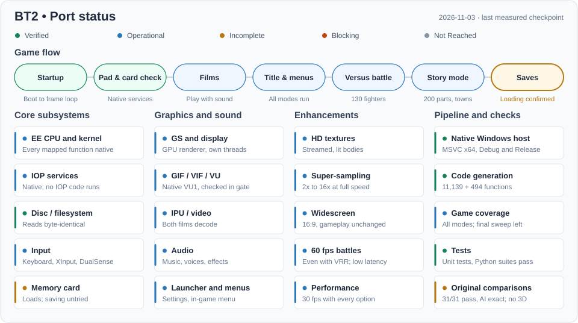

# Current progress

Target: *Dragon Ball Z: Budokai Tenkaichi 2* (SLUS-21441), a native Windows x64 port: recompiled game code on a minimal native layer ([implementation plan](project/IMPLEMENTATION_PLAN.md)). How each part was checked: [VALIDATION.md](progress/VALIDATION.md). Dated detail: the [November](progress/2026-11.md) and [October](progress/2026-10.md) histories.

<!-- progress-summary:start -->

| Milestone | Status |
| --- | --- |
| Startup | ✅ Verified — boot to the frame loop; key states match captures of the original |
| Controller and card checks | ✅ Verified — native services; the no-card prompt matches the original |
| Films | 🟢 Operational — logo and opening films with sound |
| Title and menus | 🟢 Operational — every main-menu mode; all Ultimate Battle Z courses, tournaments and training lessons run without input |
| Versus battle | 🟢 Operational — playable with a controller; CPU vs CPU sampled over all 130 fighters and 16 stages; the enemy AI matches PCSX2 exactly at the calls compared |
| Story mode | 🟢 Operational — all 200 parts and 73 towns run without input; not yet played through |
| Audio | 🟢 Operational — music, voices and effects; confirmed by listening (the speech-balance fix of 2026-10-20 not yet) |
| Saves | 🔧 Incomplete — loading confirmed; saving not yet tried in the game |
| Enhancements | 🟢 Operational — HD textures, super-sampling to 16x, widescreen, 60 fps battles, fast loading, beam struggles by buttons; full speed with all of them on the test PC |

**Code:** 11,139 EE functions plus 494 in the `DBZP.BIN` overlay, all compiled natively; the gate's runs and the story sweep interpret nothing · **Gate:** unit tests, Python suites, 31/31 comparisons with the original, the battle run against its baseline.
<!-- progress-summary:end -->

Status: ✅ Verified · 🟢 Operational · 🔧 Incomplete · ⛔ Blocking · ⏳ Not Reached ([definitions](project/PROGRESS_TRACKING.md)).

## Current work

- **60 fps battles, lighter on the processor** ([native fight rendering plan](plans/graphics/NATIVE_FIGHT_RENDERING_PLAN.md)): the fighters are drawn by the GPU's rasterizer and their vertices skip the per-vertex work of the second renderer; an in-between picture went from 18–19 to 13.5 ms in fullscreen with HD, and 60 fps fights are no longer shown a field late. Left: the in-between thread's VIF1/VU1 rerun and the hand-over of its GS data.
- **60 fps as the user played it (2026-11-03):** a Super Saiyan aura covered the body in every in-between picture (the game's own effects stayed a frame ahead); the game-built effects, dust, sky and radar are now blended too ([60 fps plan](plans/graphics/HIGH_FRAME_RATE_PLAN.md)). Since: the pacer keeps the game's core awake (late flips came from a sleeping core) and the in-between picture goes out from its own thread exactly a field after the flip's: pictures a field apart within 1 ms (97%), flip to screen 11 ms instead of 25; "Variable refresh rate" as a setting for VRR displays. The steady judder the user still felt came from GPU completion (a VRR panel shows a picture when its GPU work ends: main pictures 8.5 ms after their present, in-between ones 1.4): pictures are now presented by it, 97% a field apart on the panel. Open: the user's look; the main picture's GPU time (it now reaches the panel 16.6 ms after its flip); bones left at the newer pose.
- **Done 2026-11-03:** the enemy AI checked against PCSX2 ([plan](plans/ee/AI_VERIFICATION_PLAN.md)): exact at three calls after four floating-point rounding fixes that apply to the whole game; beam struggles by one button; "Return to the title screen" in the in-game menu; fast loading on by default.

## Waiting for the user's play

Built and checked by measurements or pictures, not yet seen in play: the 60 fps aura fix; Variable refresh rate; beam struggles by buttons; the HD outline a game pixel wide (face shimmer fix); the dialogue text's shadow with HD; the light depth of field; 60 fps with the fighters pass; saving to a card. Open reports: a texture glitch in the first fight with HD (not reproduced headless).

## Measurements

One PC (Core i9-10900K, Radeon RX 6800 XT), Release, a versus or story fight at every enhancement (16x, HD, widescreen, 60 fps), in fullscreen or a window ([performance findings](reference/PERFORMANCE_FINDINGS.md)).

| Item | Value |
| --- | --- |
| Fight | 29.97 flips per second, super attacks included; 98% of in-between pictures shown, 13.5 ms each |
| Game thread | 10 to 14 ms of a 33 ms frame in a fight |
| Graphics card | 6 ms a frame plain, about 8 to 10 with 16x, HD and widescreen |
| Latency (flip to screen) | 10 ms in menus; in a 60 fps fight in fullscreen with VRR a main picture on the panel 16.6 ms after its flip, pictures a field apart within 1 ms (97%), timed by their GPU work's end |
| Memory | 0.7 GB (0.85 GB with every enhancement); 0.8 to 1.2 GB of video memory |

## Subsystems

| Subsystem | Status | Scope |
| --- | --- | --- |
| EE CPU and kernel | 🟢 Operational | Every mapped function compiled; floating point rounded as the EE does it; threads, semaphores, interrupts |
| IOP services | 🟢 Operational | Native disc, file, controller, memory card, sound and CRI services; no IOP code runs ([plan](plans/iop/NATIVE_SERVICES_PLAN.md)) |
| GS and display | 🟢 Operational | paraLLEl-GS on its own threads, with native passes for the outline, glow and fighters |
| GIF / VIF / VU | 🟢 Operational | DMA as the game uses it; VU1 programs native, checked in the gate |
| IPU / video | 🟢 Operational | Both films decode through the game's Sofdec library |
| Audio | 🟢 Operational | ADX streams and a native effects sampler, 48 kHz stereo ([plan](plans/sound/SOUND_OUTPUT_PLAN.md)) |
| Input | 🟢 Operational | Keyboard, XInput and DualSense; mapping in the launcher and the in-game menu |
| Memory card | 🔧 Incomplete | A host folder per card; loading confirmed, saving untried ([plan](plans/memory-card/MEMORY_CARD_PLAN.md)) |
| Disc / filesystem | ✅ Verified | ISO reads; archive table and overlay byte-identical to the original |

## Next

In the [implementation plan](project/IMPLEMENTATION_PLAN.md)'s order:

1. 60 fps: the user's look after the aura fix, the open items above, the load work; then the [responsiveness plan](plans/ee/RESPONSIVENESS_PLAN.md)'s remaining steps.
2. Picture: an edge filter; FSR 1 on hold ([image quality plan](plans/graphics/IMAGE_QUALITY_PLAN.md)).
3. The user's play-testing: saving, the enhancements, the items above.
4. Final validation: the exhaustive battle sweep; 3D frames compared with the original.

**Not compared with the original yet:** memory card replies, GS readback pixels, 3D frames, VU1 memory.

[Active handoff](progress/ACTIVE_PASS.md) · [latest.json](progress/latest.json) · [components.json](progress/components.json) · [reference architecture](reference/REFERENCE_ARCHITECTURE.md) · [runtime layout](guides/RUNTIME_LAYOUT.md) · [tools](guides/TOOLS.md) · [reverse-engineering evidence](reference/REVERSE_ENGINEERING.md)
